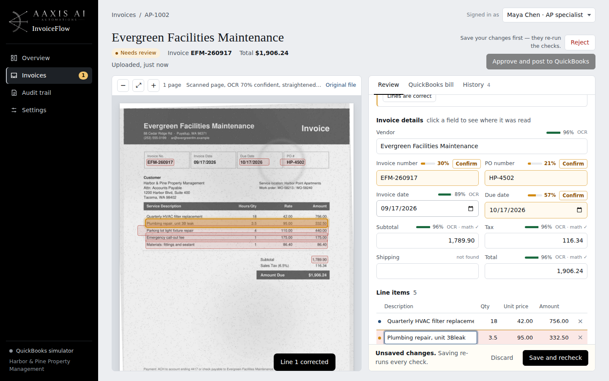
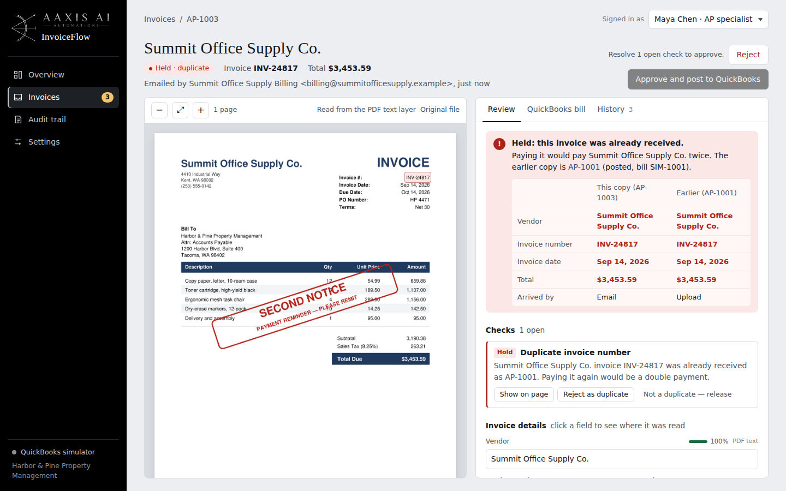
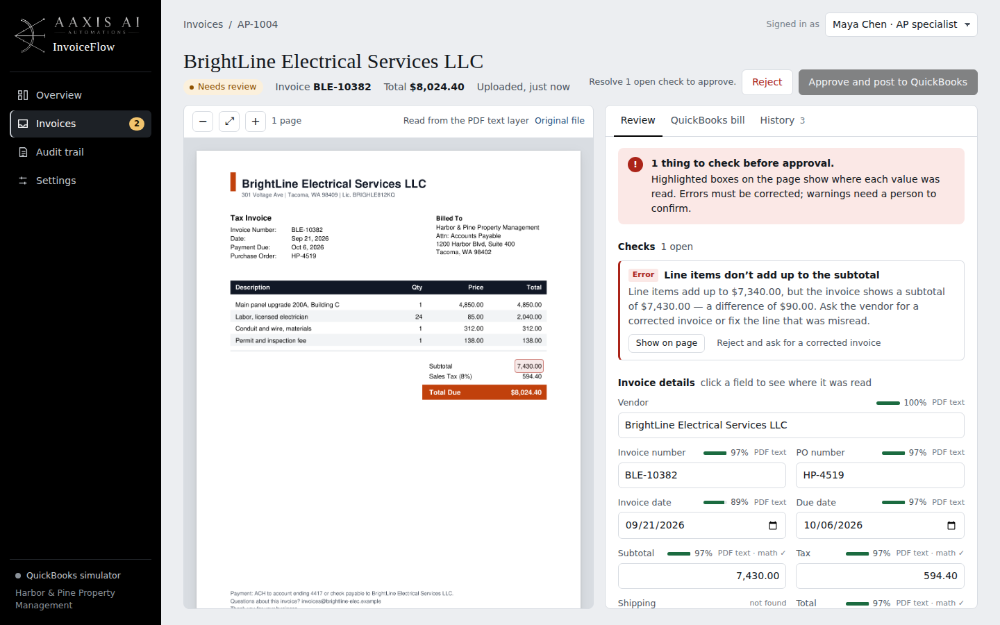
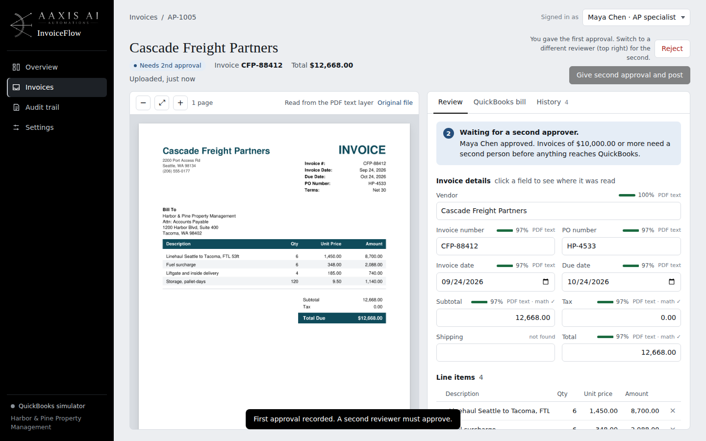
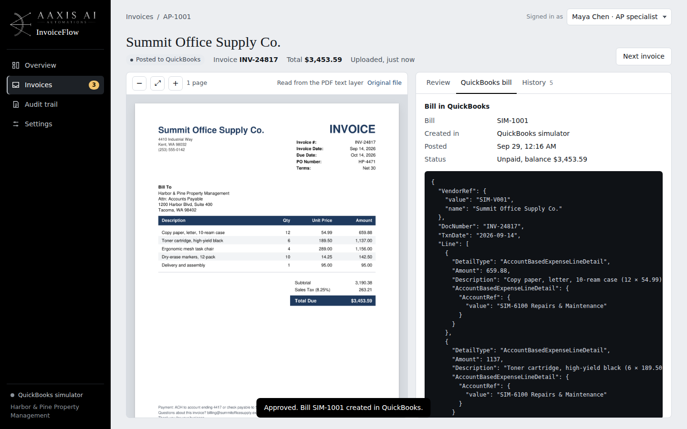
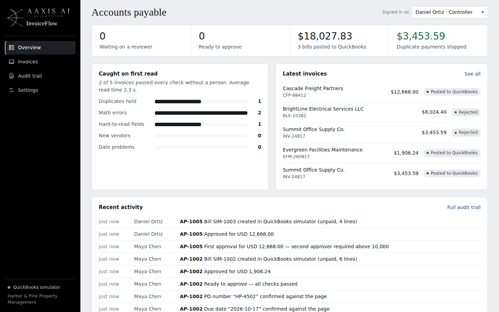
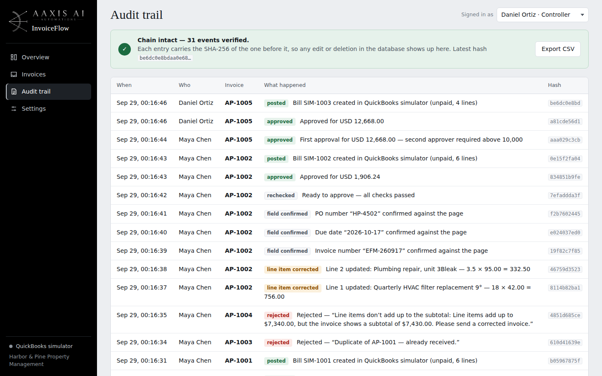
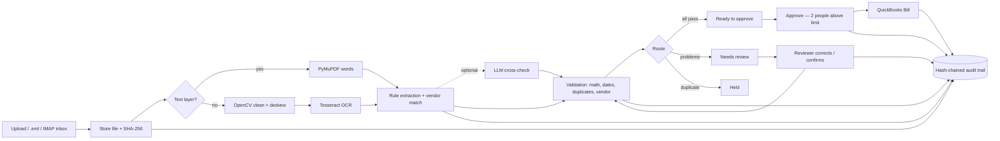

# AAXIS InvoiceFlow

**Invoice capture with human review, posting to QuickBooks Online.**
Built by AAXIS AI — AI automation, document intelligence and custom LLM applications.

InvoiceFlow takes vendor invoices from uploads or an AP email inbox, reads them (PDF text or OCR on scans and phone photos), checks the math, looks for duplicates and unknown vendors, and puts only the problems in front of a person. Nothing reaches the books until someone approves it; big invoices need two people. Every action is written to a tamper-evident audit trail.

> The selling point isn't the OCR. It's that **a clerk sees exactly what's wrong, where it is on the page, and fixes it in seconds** — and that duplicate and mis-added invoices never get paid.



| | |
|---|---|
|  |  |
|  |  |
|  |  |

---

## The demo: accounts payable at a property management company

Scenario: *Harbor & Pine Property Management* receives invoices from office, maintenance, electrical and freight vendors. All vendors in the demo are fictional.

| # | Case | What arrives | What InvoiceFlow does |
|---|------|--------------|-----------------------|
| 1 | **Clean invoice** | Summit Office Supply, text PDF, $3,453.59 | Every check passes → *Ready to approve* in one click |
| 2 | **Poor scan** | Evergreen Facilities, skewed, speckled, coffee-stained scanned PDF | Straightens 1.6°, OCRs it, reads all header fields — then flags the three it wasn't sure of and two line items where OCR dropped a decimal point. Suggests the fix ("unit price 42.00?") |
| 3 | **Duplicate** | Same Summit invoice re-sent by email as a "SECOND NOTICE" (.eml) | *Held as duplicate* with a side-by-side comparison against the original. The rotated stamp text is ignored so it can't corrupt the line items |
| 4 | **Math mismatch** | BrightLine Electrical: lines add to $7,340.00, subtotal printed as $7,430.00 | *Error* — $90.00 over-billing caught; one click rejects it with a vendor-ready reason |
| 5 | Bonus: **high value** | Cascade Freight, $12,668.00 | Clean, but over the $10,000 limit → needs a **second, different** approver |

**Measured on the demo set** (sandbox machine, CPU only): text PDFs process in 40–120 ms; the scanned page in ~10 s. 2 of 5 invoices passed straight through, $3,453.59 of duplicate payment was stopped, and a $90.00 billing error was caught. These are demo results, not production benchmarks.

## Features

**Intake**
- Drag-and-drop PDFs, scanned PDFs, phone photos (JPG/PNG/TIFF) and forwarded emails (`.eml`)
- IMAP polling of a shared AP inbox (e.g. Gmail with an app password); sender is recorded with each invoice
- SHA-256 fingerprint of every file

**Reading**
- PDF text layer read exactly; rotated text (stamps, watermarks) filtered out
- Scans/photos: OpenCV deskew (projection-profile), denoise, contrast → Tesseract OCR with per-word confidence
- Rule-based extraction of vendor, invoice #, PO #, dates, subtotal, tax, shipping, total and line items — handles label-beside-value and label-above-value layouts
- Vendor matched against the approved-vendor list (fuzzy); due date calculated from vendor terms if missing
- **Optional AI cross-check** (Anthropic or OpenAI): a second independent reading; agreement raises confidence, disagreement goes to a person

**Validation**
- Qty × price = amount per line; lines = subtotal; subtotal + tax + shipping = total
- Suggested fixes for dropped/misplaced decimal points
- Duplicates: same file, same vendor + invoice number, or same vendor + amount within N days
- New/unknown vendor warning (common invoice-fraud route), future/impossible dates, stale invoices, unusual tax rates, foreign currency

**Review (the product)**
- Split screen: the page on the left with **evidence highlights** — click any field and the page highlights where it was read
- Confidence meter and source on every field; low-confidence reads outlined
- "Ledger tape" proving the math line by line, recalculating live as you type
- One-click actions per problem: confirm, correct, apply suggested fix, add vendor, acknowledge with a note, release a duplicate hold (reason required), reject with a reason
- Two-person approval above a configurable limit (the same person can't approve twice)

**Posting**
- QuickBooks Online Accounting API: vendor lookup/create, Bill with one expense line per invoice line + tax/shipping, `DocNumber`, due date, approver note
- Idempotent: checks for an existing Bill with that DocNumber and uses `requestid` so retries never double-post
- **Simulator mode** when no keys are set — builds the identical payload so the demo works anywhere
- QuickBooks has no draft state for Bills; bills are created **unpaid** (nothing is paid until someone schedules payment)

**Audit**
- Every event (received, extracted, each field corrected, approvals, posting, rejections) is hash-chained with SHA-256; editing or deleting a row in the database is detected
- CSV export for auditors

## Architecture



**Stack:** Python 3.10+, FastAPI, SQLite, PyMuPDF, OpenCV, Tesseract, RapidFuzz, Jinja2 + vanilla JS (no build step), httpx for the QuickBooks and LLM APIs.

```
aaxis-invoiceflow/
├── app/
│   ├── main.py          FastAPI routes: pages + JSON API
│   ├── pipeline.py      ingest → read → extract → validate → route; every reviewer action
│   ├── documents.py     PDF text layer, OCR, deskew, page images
│   ├── layout.py        words → lines → cells
│   ├── extract.py       field + line-item extraction, parsers, confidence
│   ├── validate.py      business rules, duplicate detection, routing
│   ├── llm.py           optional Anthropic/OpenAI cross-check
│   ├── quickbooks.py    OAuth 2.0, Bill creation, simulator
│   ├── emailin.py       .eml parsing, IMAP polling
│   ├── audit.py         hash-chained audit trail
│   ├── templates/       dashboard, invoices, review, audit, settings
│   └── static/          CSS, JS, AAXIS AI logo
├── demo/generate_invoices.py   builds the 5 demo invoices
├── scripts/run_demo.py         loads them through the real pipeline
├── tests/test_pipeline.py      20 end-to-end tests
└── InvoiceFlow_Colab.ipynb     run it in Google Colab
```

## Run it

### Deploy free with a shareable link
See **[DEPLOY.md](DEPLOY.md)**: Render free plan, Docker (Tesseract included), demo invoices auto-loaded, optional `ACCESS_PASSWORD`.

### Google Colab (no install)
1. Unzip this folder into Google Drive, e.g. `MyDrive/aaxis-invoiceflow`.
2. Open `InvoiceFlow_Colab.ipynb` in Colab and run the cells top to bottom.
3. Click the link printed by the "Open the app" cell. Then **Load demo invoices**.

### Locally
```bash
# Tesseract: macOS `brew install tesseract` · Ubuntu `sudo apt install tesseract-ocr`
# Windows: install from github.com/UB-Mannheim/tesseract and set TESSERACT_CMD in .env
python -m venv .venv && source .venv/bin/activate
pip install -r requirements.txt
cp .env.example .env          # optional
python demo/generate_invoices.py
python -m pytest -q           # 20 tests
python run.py                 # http://localhost:8000
```

### Connect a real QuickBooks sandbox (optional)
1. Create an app at [developer.intuit.com](https://developer.intuit.com) — a sandbox company comes with it.
2. Put `QBO_CLIENT_ID` and `QBO_CLIENT_SECRET` in `.env`.
3. Either register `QBO_REDIRECT_URI` in the Intuit app and click **Settings → Connect QuickBooks**, or (easiest on Colab) use Intuit's **OAuth 2.0 Playground** to get `QBO_REALM_ID` + `QBO_REFRESH_TOKEN` and paste them into `.env`.
4. Restart. The sidebar shows **QuickBooks sandbox**; approved invoices now create real Bills.

## API
Interactive docs at `/docs`. Main endpoints:

| Method | Path | |
|---|---|---|
| POST | `/api/invoices/upload` | multipart `files` (PDF, image, .eml) |
| GET | `/api/invoices/{id}` | fields with confidence + evidence boxes, line items, issues, history |
| POST | `/api/invoices/{id}/save` | `{fields, confirm, line_items}` — re-runs every check |
| POST | `/api/invoices/{id}/issues/{issue}/acknowledge` | `{note}` |
| POST | `/api/invoices/{id}/approve` | `{note}` — posts when approvals are complete |
| POST | `/api/invoices/{id}/reject` | `{reason}` |
| GET | `/api/invoices/{id}/quickbooks-preview` | exact Bill payload |
| POST | `/api/email/poll` | import unread invoices from the AP inbox |
| GET | `/api/audit/verify` · `/api/audit/export.csv` | chain check · export |

Reviewer identity is sent as the `X-Actor` header (chosen top-right in the UI).

## Taking it to production
This is a complete, working demo. For a client deployment, the usual next steps are: SSO/role-based access instead of the reviewer picker; Postgres and object storage instead of SQLite and local files; a background worker (Celery/RQ) for OCR; per-client vendor lists and GL-account mapping; PO and receipt matching (3-way match); and Xero/NetSuite connectors alongside QuickBooks.

---
© AAXIS AI — AI automation, RAG knowledge systems, AI agents and document intelligence.
